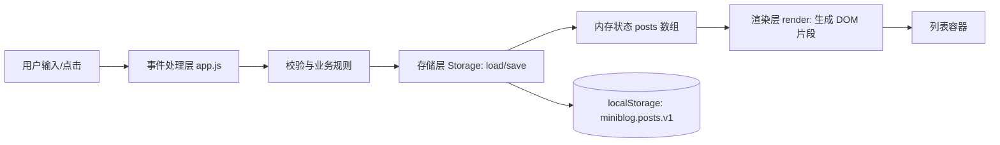

## 产品概述
一个纯前端、零依赖的「短消息社交应用」最小可用版本（MVP）。用户打开网页即可发布一条纯文本动态，并以时间倒序查看全部历史动态；数据全部保存在浏览器本地，刷新或重开浏览器后依然存在。产品命名与视觉均独立设计，**文档与代码中不得出现任何既有社交产品名称或字样**，避免侵权。

## 核心功能
- **发布动态**：文本输入框 + 实时字数统计，非空校验、超长拦截，提交后清空输入并立即出现在列表顶部。
- **查看动态列表**：时间倒序展示，每条含内容、发布时间（相对时间如"3 分钟前"）、删除操作；无数据时展示空状态引导文案。
- **本地持久化**：所有动态写入浏览器本地存储，刷新/关闭重开后数据完整保留；存储数据损坏时可安全降级为空列表，不白屏、不报错。
- **删除动态**：可删除单条动态，二次确认，删除后立即从列表和本地存储中移除。
- **自包含交付**：双击页面文件即可运行，无需安装、无需构建、无需联网。

## 视觉与体验
现代简洁风格：浅色背景 + 柔和渐变强调色，卡片化动态列表，圆角与轻投影，聚焦时输入框有柔和高亮；移动端单列自适应，桌面端居中窄栏布局（类似信息流阅读宽度）。交互上有按钮悬停、卡片进入、点赞/删除等微动效，整体"轻、干净、有呼吸感"，与任何现有社交产品的品牌视觉无雷同。

## 配套交付物
1. 一份**具体可执行的需求文档**（`docs/REQUIREMENTS.md`）：产品定位与命名说明、范围边界、功能需求清单（含优先级与验收标准）、非功能需求、数据模型与存储规范、页面结构与交互流程、视觉与文案规范、版本规划、Git 协作规范。
2. 使用说明 `README.md`（如何运行、如何二次开发、目录说明）。
3. Git 仓库初始化 + 分次语义化提交，**用 gh CLI 在当前账号 `wxywk117` 下新建公开（public）仓库 `mini-blog`**，将 `main` 分支推送至该远程仓库。

## 技术栈选择
- 结构：原生 HTML5（单页 `index.html`）
- 样式：原生 CSS3（CSS 变量 + Flex/Grid + `prefers-color-scheme` 可选增强），不引入任何 CSS 框架
- 逻辑：原生 JavaScript ES6+（`var`/严格模式不需要，使用 IIFE 或顶层模块化分段），不使用任何构建工具与 npm 依赖
- 存储：`window.localStorage`，单一版本化 key
- 版本管理：Git（PowerShell 环境），远程托管 GitHub（public 仓库 `mini-blog`）
- 运行方式：直接双击 `index.html` 或 `python -m http.server` / VS Code Live Server 预览

选择理由：需求明确要求"纯 HTML + CSS + JavaScript"且"最小可用"，零依赖方案能保证双击可运行、无构建失败风险、评审成本最低；同时用 CSS 变量与 JS 分层函数保留后续扩展（如点赞、图片、多用户）的空间，不引入过度设计。

## 实现方案
### 整体策略
三层清晰分层（结构 / 表现 / 数据逻辑），以「单一数据源 + 全量渲染」的方式实现最简数据流：所有动态存于内存数组，任何变更（新增/删除）先写回 localStorage，再触发一次列表重渲染。列表规模在 MVP 阶段（个人本地使用，量级几十到几百条）全量重渲染成本可忽略，避免引入 diff/增量更新等不必要复杂度。



### 关键设计决策
1. **存储层隔离**：封装 `loadPosts()` / `savePosts(list)` / `safeParse()`。`loadPosts` 需处理三种异常：key 不存在（返回 `[]`）、JSON 解析失败（返回 `[]` 并保留原值不覆盖，可 `console.warn`）、内容不是数组（返回 `[]`）。所有读写包裹 `try/catch`，防止隐私模式/配额超限导致整页崩溃。
2. **防 XSS 优先**：动态内容一律通过 `textContent` 或 `createTextNode` 写入 DOM，**禁止**把用户输入拼接进 `innerHTML`；仅对固定静态结构使用模板字符串。
3. **ID 生成**：优先 `crypto.randomUUID()`，不可用时回退 `Date.now().toString(36) + Math.random().toString(36).slice(2, 8)`，保证同一毫秒内多次发布不冲突。
4. **计数器与按钮态**：单一 `updateComposerState()` 统一驱动字数计数文案、超限红色提示、发布按钮 `disabled` 状态，所有输入事件只调用该函数，避免状态分散。
5. **相对时间**：`formatRelativeTime(ts)` 纯函数（<1 分钟"刚刚"、<1 小时"x 分钟前"、<24 小时"x 小时前"、<7 天"x 天前"、否则 `YYYY-MM-DD`）；用 `setInterval` 每 60 秒仅刷新时间文本节点（给时间节点加 `data-ts`，避免整列表重渲染）。
6. **渲染性能**：`DocumentFragment` 批量插入；若后续数据量增大，仅在 `posts.length > 200` 时截断为最近 200 条渲染（MVP 默认渲染全部，但代码中预留 `MAX_RENDER` 常量并注释）。
7. **可访问性**：输入框绑定 `label`/`aria-label`，字数与错误提示使用 `aria-live="polite"`，删除按钮提供 `aria-label`，支持 `Ctrl/Cmd + Enter` 快捷发布。

### 实现注意事项
- **命名避让**：产品名、页面 title、文案、CSS 类名前缀（统一 `mb-`）、存储 key（`miniblog.*`）全部使用自造中性命名；文档中描述"类微博/推特"时统一改写为"短消息社交应用"，避免任何形式的品牌字样出现在交付物中。
- **浏览器兼容**：目标为近两年 Chrome/Edge/Firefox/Safari 桌面与移动端；不使用实验性 API（`crypto.randomUUID` 已做回退）。
- **时间与排序**：新增时 `unshift` 到数组头部即可保证倒序；读取后再按 `createdAt` 降序排序一次，防止历史数据顺序错乱。
- **删除确认**：使用原生 `confirm()` 或自定义轻量弹层（MVP 建议原生 `confirm()`，减少代码量），删除需同时更新内存与 localStorage。
- **Git 与远程发布**：`git init -b main`，分三次提交（`chore: 初始化项目结构`、`docs: 新增需求文档与使用说明`、`feat: 实现发布与查看最短可用流程`）；随后执行 `gh repo create mini-blog --public --source=. --remote=origin --description="..."`（账号 `wxywk117`，已验证 gh 登录），再 `git push -u origin main`；推送完成后用 `gh repo view --json url` 取回仓库地址并输出给用户。若仓库名 `mini-blog` 已被占用，则回退为 `mini-blog-app` 并说明。
- 不要在仓库中提交任何本地临时文件（`.DS_Store`、`Thumbs.db`、`.vscode/`、`node_modules/`），通过 `.gitignore` 约束。

## 目录结构
```
d:/WXY/weibo/
├── index.html          # [NEW] 页面骨架。含 <head> 元信息（title/description/viewport）、页头品牌区（自造 Logo + 名称 + 一句话 slogan）、发布区（textarea + 字数计数 + 发布按钮 + 提示文案）、信息流容器（<ul id="post-list"> + 空状态模板）、页脚。不含内联脚本与内联样式，通过 link/script 引入外部文件。
├── styles.css          # [NEW] 全部样式。定义 :root CSS 变量（主色/渐变/背景/文字/圆角/阴影/间距）、reset、布局（桌面居中窄栏 + 移动端满宽）、发布卡片、动态卡片、空状态、按钮/禁用/错误态、微动效（hover/进入动画）、响应式断点（<=640px）与 prefers-reduced-motion 降级。
├── app.js              # [NEW] 全部逻辑。分段组织：常量配置区（STORAGE_KEY/MAX_LEN/MAX_RENDER）、存储层（loadPosts/savePosts/safeParse）、工具层（generateId/formatRelativeTime/escapeInput 校验）、业务层（createPost/deletePost 含校验）、渲染层（renderList/renderPost/updateComposerState/refreshTimeLabels）、事件绑定区（input/click/keydown/confirm）+ DOMContentLoaded 初始化。
├── docs/
│   └── REQUIREMENTS.md # [NEW] 具体需求文档。章节：1 文档信息与修订记录；2 产品定位、命名与不侵权声明；3 目标用户与使用场景；4 范围（In Scope / Out of Scope 明确边界）；5 功能需求表（FR-01 发布、FR-02 查看列表、FR-03 本地持久化、FR-04 删除、FR-05 字数与空值校验、FR-06 空状态、FR-07 相对时间，含优先级 P0/P1 与验收标准）；6 非功能需求（NFR：性能、兼容性、可用性、可访问性、代码质量、安全）；7 数据模型与存储规范（字段表、示例 JSON、key 版本策略、异常容错、容量上限说明）；8 页面结构与交互流程（区块说明 + 主流程图）；9 视觉与文案规范（色彩、字号、间距、文案口径）；10 验收清单（Given-When-Then 表格）；11 版本规划（v1.0 MVP 与后续候选）；12 Git 与协作规范（分支、提交信息、发布流程，含公开仓库说明）。
├── README.md           # [NEW] 使用说明。项目简介（中性命名）、特性列表、快速开始（双击打开 / 本地静态服务命令）、目录结构、数据存储说明与清空方法、后续扩展建议、Git 远程配置与推送说明。
└── .gitignore          # [NEW] 忽略系统与编辑器临时文件、日志、本地环境文件。
```

## 关键数据结构
```json
{
  "id": "d3f1c0a2-...",
  "content": "今天的天气很好（<= 280 字符，已 trim）",
  "createdAt": 1763020800000,
  "author": "我"
}
```
存储位置：`localStorage["miniblog.posts.v1"] = JSON.stringify(Post[])`，按 `createdAt` 降序排列。

## 设计风格
采用「轻玻璃拟态 + 现代极简信息流」风格：大面积柔白/淡灰蓝背景，主内容区为半透明白卡片配 1px 极浅描边与柔和多层阴影；顶部品牌栏与发布卡片使用低饱和度的靛紫→紫罗兰渐变点缀，仅用于强调（按钮、Logo、聚焦描边、头像占位），保证长时间阅读不刺眼。整体气质清爽、克制、有呼吸感，不模仿任何现有社交产品的品牌色与图标语言。

## 页面结构（单页）
1. **顶栏 Topbar**：左侧自造几何 Logo（渐变圆角方块内嵌抽象对话气泡）+ 产品名 + 副标语「记录此刻，只属于你」；右侧显示本地动态总数徽标。桌面吸顶 + 毛玻璃背景模糊，滚动时淡入分割线。
2. **发布卡片 Composer**：单张浮起卡片，含圆形渐变小头像 + 多行 textarea（自适应高度，占位提示「记录点什么…」）；底部工具条左侧显示 `已输入 xx / 280`（接近上限变橙、超限变红并抖动），右侧渐变主按钮「发布」（空内容时置灰禁用，hover 上浮 + 光晕，点击有轻微按下反馈）。
3. **信息流 Feed**：标题行「最新动态」+ 数量说明；每条动态为独立卡片（头像 + 时间 + 正文 + 右下角删除图标按钮），卡片 hover 抬起 1px 并加深阴影，删除按钮仅在 hover/聚焦时显现；新发布项带 300ms 淡入下滑动画。卡片间距 12-16px，正文行长限制保证可读性。
4. **空状态 Empty**：居中的淡色插画式图标（纯 CSS/SVG 绘制）+ 主文案「还没有任何动态」+ 辅助文案「写下第一条记录，它只会保存在你的浏览器里」+ 指向上方输入区的轻提示。
5. **页脚 Footer**：极简分隔线 + 说明文案「数据仅保存在本地浏览器，清空浏览器数据将一并清除」+ 当前构建版本号。

## 交互与响应式
- 支持 `Ctrl/Cmd + Enter` 快捷发布；发布成功后输入框清空、按钮回到禁用态、列表滚动到顶部、新卡片高亮闪烁一次。
- 删除使用原生确认，确认后卡片执行 180ms 淡出收缩动画再移除；删除最后一条后自动切回空状态。
- 桌面端内容区最大宽度 640px 居中，两侧留白充足；平板（<=900px）内边距收窄；移动端（<=640px）单列满宽、卡片圆角减小、顶部栏高度压缩、按钮增大触控热区（>=44px）。
- 全部动效遵循 `prefers-reduced-motion` 关闭；焦点态提供清晰的高对比描边，键盘可完整操作。

## Agent Extensions
### Skill
- **agent-browser**
  - Purpose: 在实现完成后自动打开 `index.html`，执行"发布一条动态 → 校验列表与计数 → 刷新页面 → 校验数据仍在 → 删除 → 校验回到空状态"的端到端验证，并截图留证。
  - Expected outcome: 输出可复现的功能验证结论（每条断言通过/失败）与至少 2 张界面截图，证明 MVP 主流程真实可用且无控制台报错。
