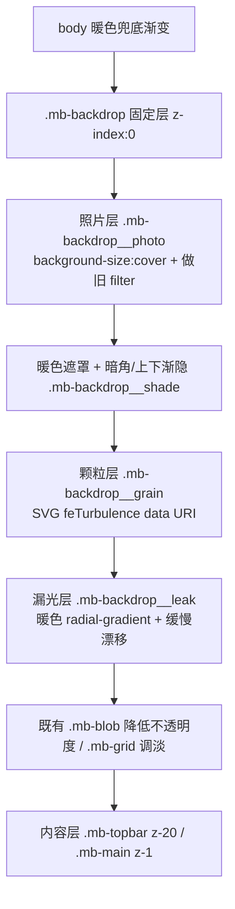

## 需求概述
在现有「小记 MiniBlog」页面上新增一张本地怀旧背景图片，整体采用**胶片老照片风**，在不影响信息阅读和完善保留现有功能的前提下，提升页面的年代氛围。

## 具体内容
- 在仓库内新增 `assets/` 目录并放置一张自制/生成的复古照片（无品牌标识、无招牌文字、无可识别人物），页面通过本地相对路径引用，**不依赖外网**，双击 `index.html` 仍可离线打开。
- 背景图铺满全屏并固定，随页面滚动保持不动；图片经过统一做旧处理（暖黄色调、轻微褪色、低对比），不是直接使用原图。
- 在背景图上叠加四层氛围效果：暖色遮罩、暗角（四周加深）、胶片颗粒噪点、暖色漏光光斑；原有的淡紫光斑与网格调淡后融入整体，避免与暖色调冲突。
- 首屏与页尾增加浅色渐隐层，中部保留照片可见度，确保顶栏标题、输入框、动态正文的文字对比度不下降。
- 卡片与顶栏由原来的冷白半透明改为暖白半透明（略微提高不透明度），形成"老照片相纸 + 玻璃卡片"的层次感；圆角、阴影、动效、布局结构保持不变。
- 桌面与移动端均正常：移动端背景仍然铺满且不产生横向滚动条；系统开启"减少动态效果"时，漏光漂移动画停止。
- 文档同步补充背景素材的来源、生成方式、体积与更换方法，避免文档与实现不一致。

## 视觉预期
打开页面第一眼是一张泛黄的老照片在背后缓缓铺开，颗粒与漏光带来胶片质感；前景内容仍是干净通透的白色卡片，紫色渐变按钮作为唯一冷色点缀，形成"旧胶片 + 新界面"的对撞而不杂乱。


## 技术栈选择
- 继续沿用现有技术栈：原生 HTML5 + 原生 CSS3 + 原生 JavaScript（`index.html` / `styles.css` / `app.js`），零依赖、零构建、离线可运行。
- 背景图：单张本地 JPG/WebP（`assets/` 目录），通过 [skill:多模态内容生成] 生成，体积控制在 300KB 以内。
- 视觉层效果（颗粒、暗角、漏光、色调）：纯 CSS 实现，颗粒使用内联 SVG `feTurbulence` 的 data URI，不新增额外图片文件。
- 验证：使用 [skill:agent-browser] 做真实浏览器截图与可读性核对。
- 版本管理：Git，提交推送至 `origin/main`（https://github.com/wxywk117/mini-blog）。

## 实现方案
### 整体策略
把"背景"从当前的装饰层升级为**分层的固定背景栈**，自上而下叠放：照片层 → 暖色遮罩层 → 暗角/渐隐层 → 颗粒层 → 漏光层 → 既有 blob/grid（调淡）。所有层都位于已有的 `.mb-backdrop`（`position: fixed; inset: 0; z-index: 0; pointer-events: none;`）内部，避免新建定位体系，也避免影响 `.mb-main`（z-index: 1）与 `.mb-topbar`（z-index: 20）的层叠关系。

`app.js` **不做任何改动**（纯视觉变更），保证业务逻辑零回归风险。



### 关键设计决策

1. **图片作为独立图层而非 `body` 背景**
   图片放 `.mb-backdrop__photo`（`position:absolute; inset:0;`）上，`body` 只保留暖色线性渐变的兜底背景。好处：图片加载失败时页面仍是完整的暖色纸感，不会出现白屏/纯色块；同时 `position: fixed` 的父层天然实现"背景不随滚动移动"，无需 `background-attachment: fixed`（该属性在移动端 Safari 支持不佳）。

2. **做旧效果用 CSS filter，而非二次修图**
   照片层使用 `filter: sepia(0.38) saturate(0.82) contrast(1.06) brightness(1.06)`，叠加 `transform: scale(1.04)` 消除 `filter` + `cover` 可能露出的边缘。这样更换图片时无需重新修图，任何素材套用同一套滤镜即可获得统一胶片感。

3. **可读性用"渐隐 + 提亮卡片"双重保障**
   - 背景侧：`.mb-backdrop__shade` 用 `linear-gradient(180deg, rgba(250,244,232,.94) 0%, rgba(250,244,232,.42) 26%, rgba(250,244,232,.42) 72%, rgba(250,244,232,.94) 100%)` 叠加 `radial-gradient(ellipse at 50% 45%, transparent 42%, rgba(74,52,26,.34) 100%)` 形成暗角。
   - 内容侧：`--mb-surface` 由 `rgba(255,255,255,.78)` 提到 `rgba(255,253,247,.9)`，卡片 `backdrop-filter: blur()` 保留；`--mb-border` 改为暖白 `rgba(255,252,243,.85)`。
   - 正文色 `#23242f` 不动，保证 WCAG AA 对比度（暖白底上约 13:1）。

4. **颗粒层性能**
   用 `background-image: url("data:image/svg+xml;utf8,<svg ...><filter id='n'><feTurbulence baseFrequency='0.8' numOctaves='2'/></filter><rect filter='url(%23n)'/></svg>")`，`background-repeat: repeat`、`opacity: .09`、`mix-blend-mode: overlay`，单层固定尺寸 180×180，GPU 合成一次，不随滚动重绘。相比 Canvas 逐帧绘制，这是零 JS 成本方案。

5. **漏光动画可降级**
   `.mb-backdrop__leak` 两个 `radial-gradient`（琥珀 `rgba(255,186,110,.30)` 与玫红 `rgba(255,128,110,.22)`）做 18s `alternate` 的缓慢位移/缩放，并在已有的 `@media (prefers-reduced-motion: reduce)` 块中被全局 `animation-duration: .001ms` 规则自动关闭，无需额外代码。

6. **配色收敛，避免"紫 + 黄"打架**
   既有 `.mb-blob` 的紫/玫红渐变不删除，但整体 `opacity` 从 `.55` 降到 `.16`，色相微调为暖紫（`rgba(146,104,255,.30)` 等），使其只作为焦外的浅色光晕存在；`.mb-grid` 的线条色改为暖灰 `rgba(120,96,58,.045)`，遮罩改弱。品牌色 `#5B4BFF` 仅保留在按钮、Logo、列表标题竖条上，作为唯一冷色锚点。

7. **响应式与体积**
   移动端（≤640px）背景不做裁剪切换，`background-position: 50% 38%` 保证主体不落在被裁掉的位置；图片用 `sizes` 无关的 CSS 背景，无需 `<picture>`。首屏多一次本地图片请求，JPG < 300KB 在本地文件场景几乎无感知（预计首屏可交互时间变化 < 100ms）。

### 实现注意事项
- **素材合规**：生成提示词需限定"无文字、无 logo、无品牌招牌、无可识别人脸、无车辆品牌"的中性题材（如老街石墙、旧窗格投下的光影、老式木门与藤椅、胶片静物），并在 `README` 中登记来源与用途，规避版权与肖像风险。
- **文件命名与体积**：`assets/legacy-film.jpg`；若生成结果为 PNG 且 > 300KB，用 Python 转 JPG 并压缩（`python -c "from PIL import Image; ..."`）；若环境无 Pillow 则 `python -m pip install pillow` 后执行；仍失败时降级为使用生成的原图并在提交说明中标注体积。
- **路径正确性**：`styles.css` 位于根目录，引用写作 `url("assets/legacy-film.jpg")`（相对 CSS 文件位置），不要写成 `../assets/`。
- **`.gitignore` 冲突检查**：现有规则只忽略 `/screenshots/`、`/tmp/` 等，`assets/` 不受影响，可直接纳入版本管理；不要新增忽略图片的规则。
- **不破坏可访问性**：新增层全部 `aria-hidden="true"` 或继承父层 `pointer-events: none`，不进入无障碍树，不影响 Tab 焦点顺序。
- **回归范围**：只改 `index.html` 的背景层片段与 `styles.css` 的背景/令牌/顶栏三处；不触碰 `app.js`、不改 DOM 结构与类名（既有类名 `.mb-blob`、`.mb-grid` 保留）。
- **提交拆分**：`style: 新增胶片老照片背景与暗角遮罩`（html/css/assets）与 `docs: 补充背景素材来源与更换说明`（docs/README）分开提交，提交身份沿用 `-c user.name=wxywk117 -c user.email=wxywk117@users.noreply.github.com`，不修改全局 git config。

## 目录结构
```
d:/WXY/weibo/
├── assets/
│   └── legacy-film.jpg      # [NEW] 胶片老照片背景素材。由多模态生成能力产出，中性题材（老街石墙/旧窗光影/胶片静物），无文字、无 logo、无人物面部；宽高比约 3:2，长边 1600px 左右，JPG 质量 80，体积 < 300KB。命名固定为 legacy-film.jpg，便于文档与样式统一引用。
├── index.html               # [MODIFY] 仅在 <div class="mb-backdrop"> 内部新增 4 个装饰 span：.mb-backdrop__photo（照片层）、.mb-backdrop__shade（暖色遮罩+暗角+上下渐隐）、.mb-backdrop__grain（颗粒）、.mb-backdrop__leak（漏光）；保留原有 3 个 .mb-blob 与 .mb-grid，均保持 aria-hidden="true" 与 pointer-events:none。其余结构、文案、脚本引用不动。
├── styles.css               # [MODIFY] 1) 调整 :root 令牌：--mb-surface / --mb-border / --mb-bg 改为暖白纸感，新增 --mb-film-tint、--mb-film-vignette 等局部变量；body 背景改为暖色渐变兜底。2) 在「3. 背景装饰层」后新增「3.1 胶片照片背景栈」小节，实现 .mb-backdrop__photo（cover + filter 做旧 + scale 1.04）、.mb-backdrop__shade（双层渐变遮罩）、.mb-backdrop__grain（SVG feTurbulence data URI + overlay 混合）、.mb-backdrop__leak（两个暖色 radial-gradient + 18s 漂移动画）。3) 降低 .mb-blob 不透明度并微调色相、调暖 .mb-grid 线条色。4) .mb-topbar 与 .mb-topbar.is-scrolled 背景改为暖白半透明。5) 在 ≤640px 断点内补充 background-position 微调。不新增 JS、不改动卡片布局与动画。
├── docs/REQUIREMENTS.md     # [MODIFY] 第 9 章新增「9.4 背景素材与视觉氛围」：背景图路径与用途、生成方式与合规声明（无品牌/无人物）、体积上限、做旧滤镜参数、四层叠加结构与遮罩透明度、更换素材的步骤；同步在 9.1 设计令牌表中补一行暖白表面色与背景色。
└── README.md                # [MODIFY] 「目录结构」中加入 assets/ 说明；新增「更换背景图」小节，给出替换文件名、尺寸与体积建议；在声明段落补充背景素材为自制/生成、不含第三方品牌元素。
```


## 设计方向
在原有「轻玻璃拟态 + 现代极简」基础上叠加一层**胶片老照片**质感，形成「旧相纸 + 新界面」的时间对撞。

- **氛围**：暖黄做旧、轻微褪色、胶片颗粒、边缘暗角、稀薄漏光。整体像一张被阳光晒过的老照片，被压在干净的白卡片之下。
- **背景处理**：全屏固定照片（cover），统一 `sepia + saturate + contrast` 做旧滤镜；上方叠暖白遮罩与暗角，中部透明度低、首尾透明度高，让内容区"坐"在一片柔和的旧色里。
- **内容层**：卡片从冷白半透明升级为暖白半透明（不透明度约 0.9）并保留轻模糊，边框为暖白细线，阴影分层更柔；圆角、内边距、动效体系完全沿用。
- **色彩关系**：暖色（米黄、琥珀、褪色红）为底，冷色仅剩品牌紫 `#5B4BFF` 出现在发布按钮、Logo、列表标题竖条与聚焦描边上，形成克制的高对比点缀。
- **细节**：颗粒层常驻不动；漏光以 18s 缓慢漂移（尊重减少动效偏好）；新发布卡片的紫色高亮闪烁在暖底上更显眼，交互反馈依然清晰。

## 版式与内容
页面区块顺序、栅格与断点不变：顶栏（吸顶毛玻璃）、发布卡、信息流、空状态、页脚。仅调整背景与表面色，不改任何文案与信息层级。

## Agent Extensions
### Skill
- **多模态内容生成**
  - Purpose: 生成一张符合"胶片老照片风"的复古背景照片（中性题材：老街石墙与旧窗光影 / 胶片静物），并明确要求画面内无任何文字、logo、招牌、可识别人物与车辆品牌，规避版权与肖像风险。
  - Expected outcome: 产出一张可直接落盘到 `assets/legacy-film.jpg` 的写实复古照片（横版 3:2 或 16:10），经压缩后体积小于 300KB，作为页面唯一外部图片素材。

### Skill
- **agent-browser**
  - Purpose: 在修改完成后启动本地静态服务并真实渲染页面，验证背景图正确加载、四层遮罩叠放无误、桌面与移动端布局与文字可读性正常，并截图留证。
  - Expected outcome: 输出至少 3 张截图（1280×900 桌面整页、1280×900 桌面发布后、375×812 移动端），确认无控制台报错、无横向滚动条、无背景缺失或层叠错位，正文对比度目视清晰。
