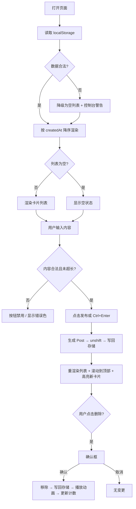

# 小记 MiniBlog 需求规格说明书

## 1. 文档信息与修订记录

| 项目 | 内容 |
| --- | --- |
| 文档名称 | 小记 MiniBlog 需求规格说明书 |
| 文档编号 | MB-REQ-001 |
| 当前版本 | v1.0.0 |
| 文档状态 | 已确认（基线） |
| 编写日期 | 2026-11-13 |
| 对应产品版本 | v1.0.0 单机本地版 |
| 适用范围 | 本项目全部前端交付物（`index.html`、`styles.css`、`app.js`） |

### 1.1 修订记录

| 版本 | 日期 | 修订内容 | 修订人 |
| --- | --- | --- | --- |
| v1.0.0 | 2026-11-13 | 首次发布，确立 MVP 功能基线、数据模型与验收标准 | 项目组 |

### 1.2 术语表

| 术语 | 说明 |
| --- | --- |
| 动态（Post） | 用户发布的一条纯文本记录，是系统唯一的核心业务实体 |
| 发布器（Composer） | 页面顶部的文本输入区域，负责录入与提交动态 |
| 信息流（Feed） | 按发布时间倒序排列的动态列表 |
| 本地存储 | 浏览器提供的 `localStorage`，容量通常为 5MB / 域名 |
| MVP | 最小可用产品，只实现能跑通核心闭环的最少功能 |

---

## 2. 产品定位、命名与不侵权声明

### 2.1 产品定位

**小记 MiniBlog** 是一个零依赖、纯前端的「短消息记录应用」。用户打开网页即可发布一条不超过 280 字的纯文本动态，并以时间倒序浏览全部历史内容。所有数据仅保存在使用者自己的浏览器中，不注册、不登录、不上传、不联网。

一句话描述：**写下此刻，留在本地。**

### 2.2 命名说明

为避免与任何既有产品或品牌产生关联或混淆，本项目在命名上全部采用自造中性标识：

| 命名对象 | 取值 | 说明 |
| --- | --- | --- |
| 产品名称 | 小记 MiniBlog | 通用描述性命名 |
| 仓库名称 | mini-blog | 与产品名一致的英文短名 |
| CSS 类名前缀 | `mb-` | 取自 MiniBlog 缩写 |
| 存储键名 | `miniblog.posts.v1` | 带产品前缀与版本号 |
| 页面标题 | 小记 MiniBlog · 记录此刻 | — |

### 2.3 不侵权声明

1. 本项目**不包含、不复制**任何第三方社交平台的名称、商标、Logo、图标、插画、配色方案、页面结构或文案。
2. 项目源码、文档、提交信息、README 中均不出现第三方产品名称或近似字样。
3. 功能层面仅实现「发布短文本 + 按时间浏览」这一通用交互范式，属于行业通用功能，不涉及任何特定产品的专有设计。
4. UI 视觉（渐变配色、玻璃拟态卡片、圆角与阴影参数）均为本项目独立设计，与任何既有产品的品牌视觉不存在对应关系。
5. 若后续需引入第三方图标或字体资源，必须使用可商用授权资源，并在 README 中登记来源与许可证。

---

## 3. 目标用户与使用场景

### 3.1 目标用户

| 用户类型 | 特征 | 核心诉求 |
| --- | --- | --- |
| 个人记录者 | 希望随手记下想法，不愿注册账号 | 打开即写，写完即走 |
| 隐私敏感用户 | 不接受内容上传到服务器 | 数据完全留在本地 |
| 前端学习者 | 想了解一个完整前端小项目的结构 | 代码短、结构清晰、可读可改 |

### 3.2 典型场景

1. **随手记录**：通勤路上想到一句话，打开页面输入后点击「发布」，内容立刻出现在列表顶部。
2. **回看历史**：几天后再次打开页面，之前写下的内容仍在，按时间倒序排列，最近的排在最上面。
3. **清理内容**：删除某条不再需要的记录，确认后该记录立即消失且不再出现。
4. **离线演示**：无网络环境下双击 `index.html` 即可完整演示发布与浏览流程。

---

## 4. 需求范围

### 4.1 本期范围内（In Scope，v1.0.0）

| 编号 | 范围项 | 说明 |
| --- | --- | --- |
| S-01 | 发布动态 | 纯文本，1–280 字符，提交后置顶显示 |
| S-02 | 查看动态 | 时间倒序单列信息流，含相对时间与总数 |
| S-03 | 本地持久化 | 写入 `localStorage`，刷新/重开浏览器后数据仍在 |
| S-04 | 删除动态 | 单条删除，二次确认，同步更新存储 |
| S-05 | 输入校验 | 空内容、纯空白、超长拦截，实时字数提示 |
| S-06 | 空状态 | 无数据时展示引导文案 |
| S-07 | 响应式 | 桌面居中窄栏，移动端单列自适应 |
| S-08 | 工程化 | Git 版本管理 + 公开远程仓库托管 |

### 4.2 本期范围外（Out of Scope，v1.0.0 明确不做）

账号注册与登录、多用户与作者体系、服务端接口与数据库、图片/视频/链接卡片、点赞·评论·转发、话题与 @ 提及、全文搜索与筛选、动态编辑、分页与无限滚动、消息通知、多语言、PWA 离线缓存、数据导入导出、主题切换。

> 以上内容列入第 11 章版本规划，不在本期实现，评审时不得作为缺陷提出。

---

## 5. 功能需求

### 5.1 需求总览

| 编号 | 功能名称 | 优先级 | 一句话说明 |
| --- | --- | --- | --- |
| FR-01 | 发布动态 | P0 | 输入文本并提交，生成一条新动态 |
| FR-02 | 查看动态列表 | P0 | 按时间倒序展示全部动态 |
| FR-03 | 本地持久化 | P0 | 数据写入本地存储并可读取还原 |
| FR-04 | 删除动态 | P1 | 删除单条动态并同步存储 |
| FR-05 | 输入校验与字数统计 | P0 | 空值/超长拦截，实时计数 |
| FR-06 | 空状态引导 | P1 | 无数据时展示引导提示 |
| FR-07 | 相对时间显示 | P1 | 以「x 分钟前」等口语化方式呈现时间 |
| FR-08 | 动态总数徽标 | P2 | 顶栏展示本地动态总条数 |
| FR-09 | 快捷发布 | P2 | `Ctrl/Cmd + Enter` 直接提交 |

优先级定义：**P0** 缺失则产品不可用；**P1** 缺失显著影响体验；**P2** 体验增强项。

### 5.2 详细说明

#### FR-01 发布动态（P0）

- **描述**：用户在发布器中输入文本，点击「发布」按钮或使用快捷键提交，生成一条新动态。
- **业务规则**：
  1. 内容长度以 `trim()` 后的字符数计，按 Unicode 码点计数（`Array.from(str).length`），上限 280。
  2. 内容为空或仅含空白字符时禁止提交。
  3. 提交成功后：内容写入内存与本地存储 → 插入列表首位 → 清空输入框 → 输入框高度复位 → 计数器归零 → 按钮回到禁用态 → 页面滚动到信息流顶部。
  4. 每次提交生成唯一 `id` 与毫秒级 `createdAt` 时间戳。
  5. 提交过程中不得出现页面刷新或跳转。
- **验收标准**：
  - 输入合法内容点击「发布」，列表顶部 1 秒内出现该内容，输入框为空。
  - 连续点击「发布」按钮不会产生重复数据（提交后按钮立即禁用）。
  - 发布第 N 条后，顶栏计数显示为 N。

#### FR-02 查看动态列表（P0）

- **描述**：页面加载完成后，展示全部历史动态，最新的排在最上方。
- **业务规则**：
  1. 排序规则：按 `createdAt` 降序；时间相同则按插入先后倒序。
  2. 每条动态展示：作者标识（默认「我」）、相对时间、正文、删除按钮。
  3. 正文保留换行（`white-space: pre-wrap`），超长单词强制换行。
  4. 列表区域标题展示「最新动态」及条数说明。
- **验收标准**：
  - 刷新页面后列表顺序与刷新前一致。
  - 正文中的换行与空格按原文呈现，HTML 标签以纯文本显示（不解析、不执行）。
  - 100 条动态数据下滚动流畅，无卡顿感。

#### FR-03 本地持久化（P0）

- **描述**：所有动态保存在 `localStorage`，刷新、关闭标签页、重开浏览器后仍可完整读取。
- **业务规则**：
  1. 存储键：`miniblog.posts.v1`，值为 `Post[]` 的 JSON 字符串。
  2. 读取时机：页面初始化阶段一次性读取。
  3. 写入时机：新增、删除后立即整体写回。
  4. 读取异常时降级为空列表，页面正常渲染，控制台输出警告，不覆盖原始损坏数据。
  5. 写入异常（配额超限、隐私模式禁用存储）时捕获异常，界面提示「保存失败」，内存状态保留本次操作结果。
- **验收标准**：
  - 发布 3 条后刷新，3 条均存在且顺序不变。
  - 手动将存储值改为非法 JSON（如 `"{{{"`）后刷新，页面正常显示空状态，控制台有警告，不出现白屏。
  - 使用无痕窗口（若禁用存储）打开，页面可用，无未捕获异常。

#### FR-04 删除动态（P1）

- **描述**：点击某条动态的删除按钮，经二次确认后移除该条动态。
- **业务规则**：
  1. 删除前弹出确认框，文案包含「删除后不可恢复」提示。
  2. 取消确认则不产生任何变更。
  3. 确认后：从内存数组移除 → 写回存储 → 卡片播放 180ms 淡出动画 → 从 DOM 移除 → 更新计数。
  4. 删除最后一条后自动切换为空状态。
- **验收标准**：
  - 删除后刷新页面，该条动态不再出现。
  - 取消确认后，动态数量与内容不变。
  - 删除后顶栏计数同步减 1。

#### FR-05 输入校验与字数统计（P0）

- **描述**：发布器实时反馈输入长度与合法性，并联动按钮可用状态。
- **业务规则**：
  1. 计数器文案：`已输入 x / 280`。
  2. `x > 250`（接近上限）时计数文案转为警示色；`x > 280` 时转为错误色并阻止提交。
  3. 内容为空白时「发布」按钮 `disabled`，视觉呈置灰态。
  4. 输入框高度随内容自适应，最大高度 200px 后内部滚动。
- **验收标准**：
  - 输入 281 个字符时，计数显示错误色，点击按钮无任何提交行为。
  - 清空输入后按钮立即回到禁用态。
  - 粘贴大段文本时计数与按钮状态同步更新。

#### FR-06 空状态引导（P1）

- **描述**：本地无任何动态时，展示空状态占位而非空白区域。
- **业务规则**：包含插画式图标 + 主文案「还没有任何动态」+ 辅助文案「写下第一条记录，它只会保存在你的浏览器里」。
- **验收标准**：首次打开页面（存储为空）时显示空状态；发布第一条后空状态隐藏；删除全部后空状态重新出现。

#### FR-07 相对时间显示（P1）

- **描述**：动态时间以口语化相对时间呈现，并随时间推移自动更新。
- **规则**：

| 时间差 | 展示 |
| --- | --- |
| < 1 分钟 | 刚刚 |
| < 60 分钟 | x 分钟前 |
| < 24 小时 | x 小时前 |
| < 7 天 | x 天前 |
| ≥ 7 天 | YYYY-MM-DD |

- **验收标准**：新建动态显示「刚刚」；页面停留期间每 60 秒自动刷新时间文案，无需手动刷新页面；时间节点带完整的 `title` 绝对时间提示。

#### FR-08 动态总数徽标（P2）

顶栏右侧徽标展示本地动态总数，随发布与删除实时更新，数量为 0 时隐藏。

#### FR-09 快捷发布（P2）

输入框内按 `Ctrl + Enter`（macOS 为 `Cmd + Enter`）触发与点击「发布」完全一致的行为，且受同样的校验约束。

---

## 6. 非功能需求

| 编号 | 类别 | 要求 |
| --- | --- | --- |
| NFR-01 | 性能 | 首屏（本地文件）可交互时间 < 1s；1000 条动态渲染耗时 < 300ms；输入事件处理不产生明显掉帧 |
| NFR-02 | 兼容性 | 支持近两年 Chrome / Edge / Firefox / Safari 桌面版及 iOS / Android 主流浏览器；不使用实验性 API，`crypto.randomUUID` 需有回退实现 |
| NFR-03 | 可用性 | 双击 `index.html` 即可运行，无构建步骤、无网络请求、无外部 CDN 依赖 |
| NFR-04 | 可访问性 | 输入框有关联 `label`；按钮有可读名称；计数与错误提示使用 `aria-live="polite"`；Tab 键可完整操作；焦点态有高对比描边 |
| NFR-05 | 安全 | 用户内容一律以文本节点写入 DOM，禁止拼接 `innerHTML`；不发起任何网络请求；不引入第三方脚本 |
| NFR-06 | 代码质量 | 原生 ES6+，按「配置 / 存储 / 业务 / 渲染 / 事件」分层；关键函数有注释；单文件不超过 400 行 |
| NFR-07 | 体积 | 全部交付文件未压缩总体积 < 120KB |
| NFR-08 | 可维护性 | 所有可调参数（字数上限、存储键名、渲染上限）集中在 `app.js` 顶部常量区 |
| NFR-09 | 响应式 | 断点 900px 与 640px；移动端触控目标 ≥ 44×44px |
| NFR-10 | 降级 | 遵循 `prefers-reduced-motion`，关闭全部动画；禁用存储时功能可降级运行 |

---

## 7. 数据模型与存储规范

### 7.1 实体：Post（动态）

| 字段 | 类型 | 必填 | 约束 | 说明 |
| --- | --- | --- | --- | --- |
| `id` | string | 是 | 全局唯一 | 优先 `crypto.randomUUID()`，回退 `时间戳36进制 + 随机串` |
| `content` | string | 是 | 1–280 字符（trim 后） | 用户输入的正文 |
| `createdAt` | number | 是 | 毫秒时间戳 | 用于排序与相对时间计算 |
| `author` | string | 是 | 固定 `"我"` | 本地单用户标识，为后续多用户预留 |

### 7.2 示例

```json
[
  {
    "id": "0f7c2b9e-3d51-4a8e-9c2f-7b1d5a6e8c30",
    "content": "今天把需求文档写完了，感觉很踏实。\n下一步开始写页面。",
    "createdAt": 1763020800000,
    "author": "我"
  }
]
```

### 7.3 存储规范

| 项 | 规范 |
| --- | --- |
| 键名 | `miniblog.posts.v1` |
| 值格式 | `JSON.stringify(Post[])`，按 `createdAt` 降序 |
| 版本策略 | 键名后缀随数据结构破坏性变更递增（`v2`、`v3`），旧键保留不删除，读取时自动迁移 |
| 写入策略 | 全量覆盖写入 |
| 容量估算 | 单条约 1KB，5MB 配额约可存 5000 条；超出配额时提示保存失败 |

### 7.4 容错矩阵

| 异常场景 | 处理策略 | 用户可见表现 |
| --- | --- | --- |
| 键不存在 | 返回空数组 | 显示空状态 |
| JSON 解析失败 | 返回空数组，保留原值不覆盖，`console.warn` | 显示空状态，可正常发布 |
| 值不是数组 | 返回空数组 | 显示空状态 |
| 数组元素缺字段 | 过滤非法项（缺 `id`/`content`/`createdAt`），其余正常渲染 | 仅展示合法数据 |
| 写入抛异常 | 捕获，保留内存状态 | 顶部提示「保存失败，刷新后可能丢失」 |
| `localStorage` 不可用 | 全流程走内存兜底，不阻塞使用 | 功能可用，刷新后数据丢失 |

---

## 8. 页面结构与交互流程

### 8.1 页面区块

| 区块 | 组成 | 关键交互 |
| --- | --- | --- |
| 顶栏 Topbar | 渐变 Logo + 产品名 + 副标语 + 动态计数徽标 | 吸顶 + 毛玻璃；滚动时下边线淡入 |
| 发布器 Composer | 渐变头像 + 多行输入框 + 计数 + 「发布」按钮 + 快捷提示 | 输入自适应、实时计数、按钮禁用联动 |
| 信息流 Feed | 「最新动态」标题 + 条数说明 + 动态卡片列表 | 卡片悬停上浮、新卡片淡入、删除按钮浮现 |
| 空状态 Empty | SVG 插画 + 主文案 + 辅助文案 | 有数据时自动隐藏 |
| 页脚 Footer | 数据说明文案 + 版本号 | 静态展示 |

### 8.2 主流程



### 8.3 交互细节

- 发布成功后新卡片高亮闪烁一次（约 1.2s 渐隐），并带 300ms 淡入下滑动画。
- 删除按钮默认透明度 0.35，卡片悬停或按钮聚焦时升至 1。
- 全部动效在 `prefers-reduced-motion: reduce` 下取消。
- 键盘操作顺序：顶栏 → 输入框 → 发布按钮 → 各卡片删除按钮。

---

## 9. 视觉与文案规范

### 9.1 设计令牌

| 令牌 | 值 | 用途 |
| --- | --- | --- |
| `--mb-primary` | `#5B4BFF` | 主色 |
| `--mb-primary-2` | `#8A5CFF` | 渐变副色 |
| `--mb-accent` | `#FF7A85` | 强调/危险辅助 |
| `--mb-bg` | `#F5F6FB` | 页面背景 |
| `--mb-surface` | `rgba(255,255,255,.78)` | 卡片表面（玻璃拟态） |
| `--mb-text` | `#14151F` | 主文字 |
| `--mb-text-muted` | `#5B6070` | 次要文字 |
| `--mb-text-faint` | `#9AA0AE` | 辅助文字 |
| `--mb-success` | `#12B76A` | 成功态 |
| `--mb-warning` | `#F79009` | 临近上限 |
| `--mb-danger` | `#F04438` | 错误/删除 |
| 圆角 | 20px（卡片）/ 12px（按钮）/ 999px（胶囊） | — |
| 阴影 | `0 18px 40px -24px rgba(52,44,120,.28)` | 卡片浮起 |

### 9.2 排版

| 层级 | 字号 | 字重 |
| --- | --- | --- |
| 主标题（产品名） | 26px | 700 |
| 区块标题 | 16px | 600 |
| 正文 | 15px | 400 |
| 辅助文字 | 13px | 400 |

字体栈：`"PingFang SC", "Microsoft YaHei", "Helvetica Neue", system-ui, sans-serif`。

### 9.3 文案口径

| 位置 | 文案 |
| --- | --- |
| 页面标题 | 小记 MiniBlog · 记录此刻 |
| 副标语 | 记录此刻，只属于你 |
| 输入占位 | 记录点什么… |
| 发布按钮 | 发布 |
| 计数 | 已输入 x / 280 |
| 超限提示 | 已超出 x 个字符 |
| 列表标题 | 最新动态 |
| 空状态主文案 | 还没有任何动态 |
| 空状态辅助文案 | 写下第一条记录，它只会保存在你的浏览器里 |
| 删除确认 | 确定删除这条动态吗？删除后不可恢复。 |
| 删除按钮无障碍名 | 删除这条动态 |
| 保存失败提示 | 保存失败，当前内容仅保留在页面中 |
| 页脚 | 数据仅保存在本地浏览器，清空浏览器数据将一并清除 |

文案要求：中文简体，语气克制、不使用夸张营销词，不使用任何第三方品牌表述，句末标点统一。

---

## 10. 验收清单

| 编号 | Given（前提） | When（操作） | Then（预期） |
| --- | --- | --- | --- |
| AC-01 | 本地无任何数据 | 打开页面 | 显示空状态，计数徽标隐藏 |
| AC-02 | 输入框为空 | 观察「发布」按钮 | 按钮为禁用态 |
| AC-03 | 输入 1 个字符 | 点击「发布」 | 列表首条出现该内容，输入框清空，计数 +1 |
| AC-04 | 输入 281 个字符 | 点击「发布」 | 无提交，计数显示错误色，提示超限数量 |
| AC-05 | 已发布 3 条 | 刷新页面 | 3 条仍在，顺序为最新在上 |
| AC-06 | 已发布 1 条 | 点击删除并在确认框点「确定」 | 卡片淡出移除，回到空状态，存储同步清空 |
| AC-07 | 已发布 1 条 | 点击删除后在确认框点「取消」 | 卡片保留，计数不变 |
| AC-08 | 存储值为 `"{{{"` | 刷新页面 | 页面正常渲染空状态，控制台有警告，无未捕获异常 |
| AC-09 | 输入 `` | 发布 | 内容以纯文本显示，不触发脚本 |
| AC-10 | 已在输入框输入内容 | 按 `Ctrl/Cmd + Enter` | 等价于点击「发布」 |
| AC-11 | 视口宽度 375px | 打开页面 | 单列布局，无横向滚动条，按钮触控高度 ≥ 44px |
| AC-12 | 系统开启「减少动态效果」 | 打开页面 | 无位移动画与闪烁动画 |
| AC-13 | 任意状态 | 打开浏览器控制台 | 无 error 级日志 |

---

## 11. 版本规划

| 版本 | 目标 | 内容 |
| --- | --- | --- |
| v1.0.0 | MVP（本期） | 发布、查看、删除、本地持久化、空状态、相对时间、响应式 |
| v1.1.0 | 内容管理增强 | 编辑动态、关键词搜索、数据导出/导入 JSON、深色模式 |
| v1.2.0 | 表达力增强 | 话题标签、字数统计优化、表情选择器 |
| v2.0.0 | 多端与协作（需后端） | 账号体系、云端同步、多设备一致性 |

v1.0.0 上线判定：第 10 章全部 AC 用例通过，控制台无 error，代码通过基础自检。

---

## 12. Git 与协作规范

### 12.1 分支策略

- `main`：主干，始终保持可运行状态，仅接受通过自检的提交。
- 功能开发分支（可选）：`feat/<简述>`、`fix/<简述>`，合并前先本地自检。

### 12.2 提交信息规范（Conventional Commits）

| 类型 | 用途 | 示例 |
| --- | --- | --- |
| `feat` | 新功能 | `feat: 实现动态发布与倒序列表` |
| `fix` | 缺陷修复 | `fix: 修复空内容仍可提交的问题` |
| `docs` | 文档变更 | `docs: 新增需求文档与使用说明` |
| `style` | 样式/格式调整 | `style: 优化卡片间距与聚焦描边` |
| `refactor` | 重构（不改行为） | `refactor: 抽离存储层读写方法` |
| `chore` | 构建/工具/杂项 | `chore: 初始化项目结构与忽略规则` |

要求：单条提交只做一件事；标题不超过 50 字；必要时空一行补充正文说明。

### 12.3 仓库与发布

1. 本地仓库主分支为 `main`。
2. 远程仓库为公开（public）托管仓库，仓库名 `mini-blog`。
3. 远程地址统一使用 `origin`。
4. 首次发布流程：本地自检 → 分次提交 → 创建远程仓库 → `git push -u origin main`。
5. 后续发布流程：功能分支开发 → 自检 → 合并 `main` → 打标签 `v1.x.x` → 推送分支与标签。
6. 仓库中不得提交系统临时文件、编辑器配置、日志与构建产物（见 `.gitignore`）。
7. 建议开启托管平台的 Pages 能力，将 `main` 分支根目录作为静态站点目录，即可在线访问该应用。

---

## 附录 A：交付物清单

| 文件 | 说明 |
| --- | --- |
| `index.html` | 页面结构（顶栏、发布器、信息流、空状态、页脚） |
| `styles.css` | 全部样式：设计令牌、布局、组件、动效、响应式 |
| `app.js` | 全部逻辑：常量、存储、业务、渲染、事件绑定 |
| `docs/REQUIREMENTS.md` | 本文档 |
| `README.md` | 使用说明与二次开发指引 |
| `.gitignore` | 忽略规则 |
